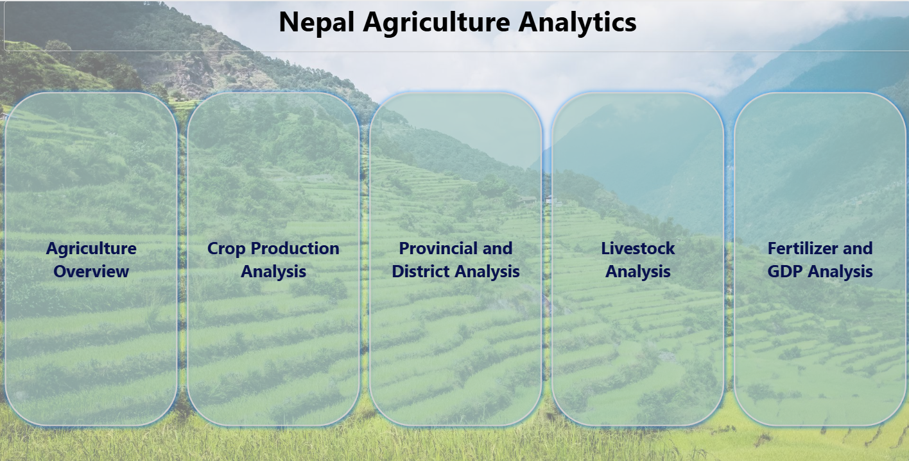
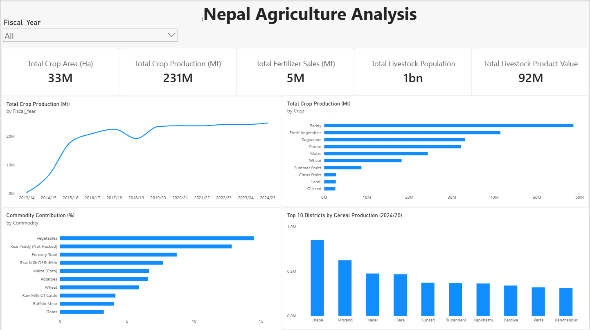
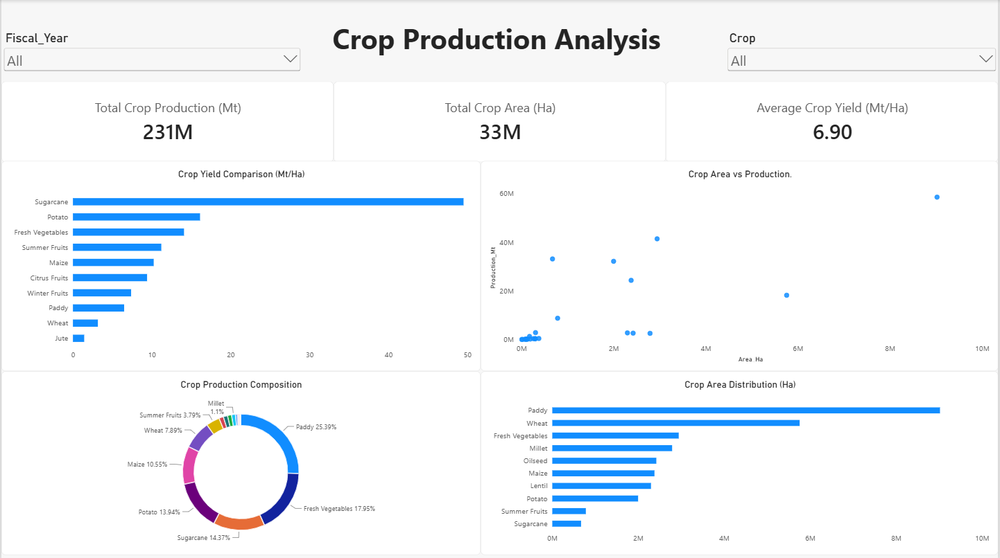
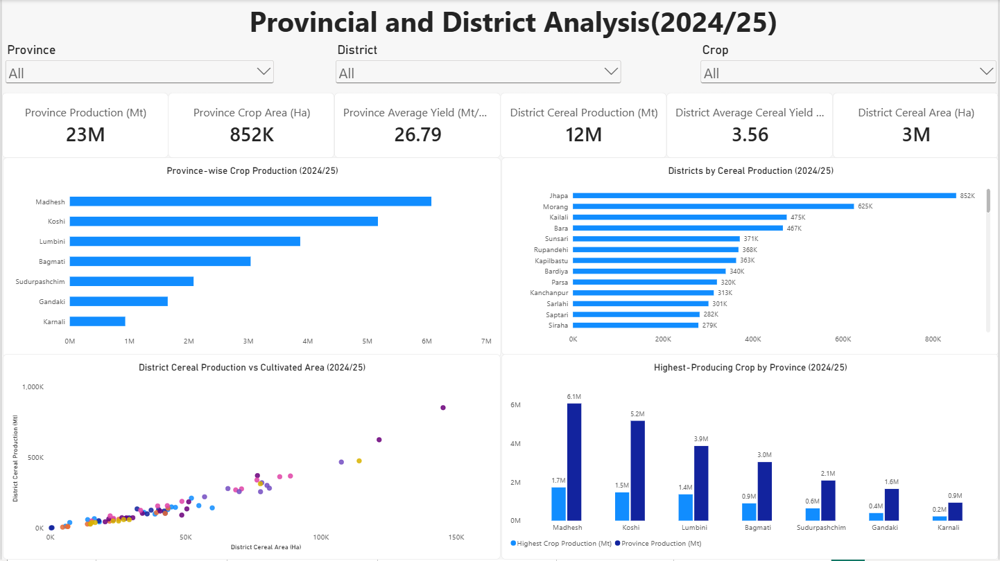
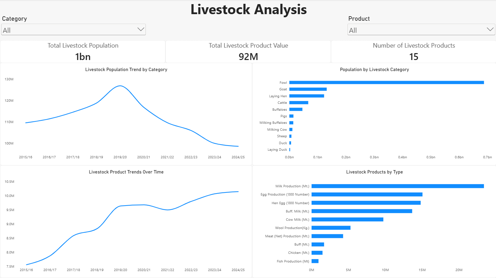
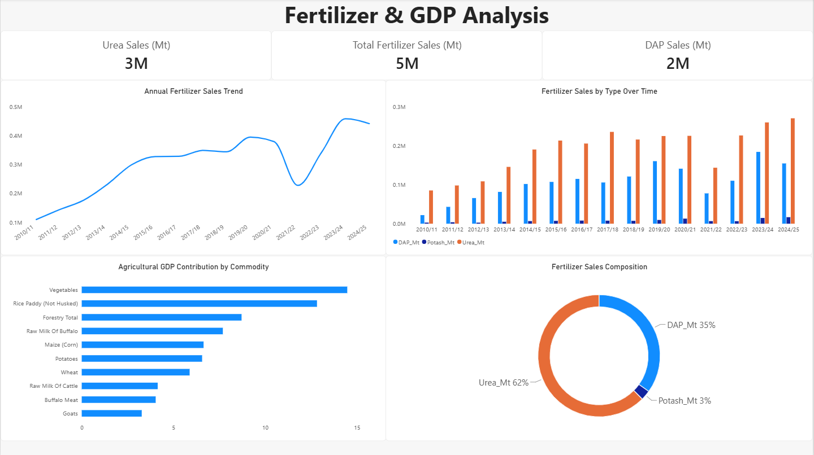

# 🇳🇵 Nepal Agriculture Analytics


> An end-to-end data analytics project exploring Nepal's agricultural sector using official agricultural statistics, with **Python, PostgreSQL, and Power BI**.

---

##  Project Overview

**Nepal Agriculture Analytics** is an end-to-end data analytics project focused on understanding Nepal's agricultural sector through data.

The project uses **13 official agricultural datasets** covering crop production, livestock, fertilizer sales, provincial and district-level agricultural production, and agricultural commodity contributions.

The analysis was performed through three complementary stages:

-  **Python** — Exploratory Data Analysis, statistical analysis, validation, and visualization
-  **PostgreSQL** — Structured SQL analysis, data-quality checks, aggregations, comparisons, and advanced SQL techniques
-  **Power BI** — Data transformation, data modeling, DAX calculations, interactive dashboards, and visual storytelling

The goal is to transform raw agricultural statistics into meaningful insights about **production trends, regional differences, crop specialization, livestock patterns, fertilizer use, and agricultural economic contribution**.

---

##  Project Objectives

The project aims to:

- Analyze historical agricultural production trends.
- Compare production, cultivated area, and yield across crop groups.
- Identify major crops and agricultural commodities.
- Compare agricultural production across provinces and districts.
- Analyze livestock population and livestock product trends.
- Examine chemical fertilizer sales over time.
- Analyze agricultural commodity contributions to GDP.
- Identify important patterns, trends, and regional differences.
- Validate source data and identify potential inconsistencies.
- Build an interactive dashboard for exploring agricultural statistics.
- Demonstrate an end-to-end data analytics workflow using Python, SQL, and Power BI.

---

# 🗂️ Dataset Overview

The project uses **13 original CSV datasets**.

The datasets cover historical agricultural statistics as well as provincial, district-level, livestock, fertilizer, and agricultural GDP data.

## Crop Production Datasets

| CSV File | Description |
|---|---|
| `01_cereal_crops_yearly.csv` | Historical cereal crop area, production, and yield |
| `04_major_cash_crops_yearly.csv` | Historical major cash crop statistics |
| `06_pulses_yearly.csv` | Historical pulse crop area, production, and yield |
| `09_major_fruits_yearly.csv` | Fruit area, productive area, production, and yield |
| `10_fresh_vegetables_yearly.csv` | Historical fresh vegetable area and production |

## Provincial & District Datasets

| CSV File | Description |
|---|---|
| `02_cereal_production_by_province_2024_25.csv` | Cereal production by province |
| `03_cereal_production_by_district_2024_25.csv` | District-level cereal production, area, and yield |
| `05_major_cash_crops_by_province_2024_25.csv` | Major cash crop statistics by province |
| `11_fresh_vegetables_by_province_2024_25.csv` | Fresh vegetable statistics by province |

## Livestock Datasets

| CSV File | Description |
|---|---|
| `07_livestock_population_yearly.csv` | Historical livestock population by category |
| `08_livestock_products_yearly.csv` | Recorded livestock product values over time |

## Fertilizer Dataset

| CSV File | Description |
|---|---|
| `12_chemical_fertilizer_sales_yearly.csv` | Annual Urea, DAP, Potash, and total fertilizer sales |

## Agricultural GDP Dataset

| CSV File | Description |
|---|---|
| `13_agriculture_gdp_commodity_contribution_2024_25.csv` | Agricultural commodity contribution percentages for FY 2024/25 |

### Data Source

The project uses official agricultural statistics from Nepal's government agricultural publications and Ministry of Agriculture sources.

The original source CSV files are preserved in:

```text
csv_source_files/
```

Dataset coverage varies by source. Historical datasets support time-series analysis, while several provincial, district, and GDP datasets represent **FY 2024/25**.

---

# 🔄 End-to-End Analytics Workflow

```text
                 Official Agricultural Data
                           │
                           ▼
                    13 Source CSVs
                           │
              ┌────────────┼────────────┐
              ▼            ▼            ▼
           Python       SQL        Power BI
              │            │            │
        EDA & Statistics   │       Power Query
        Validation         │       Data Modeling
        Visualization      │       DAX & KPIs
              │            │            │
              └────────────┼────────────┘
                           ▼
                 Agricultural Insights
                           │
                           ▼
                 Interactive Dashboard
```

---

#  Python Analysis

The Python phase focuses on **exploratory data analysis, statistical calculations, validation, aggregation, and visualization**.

### Technologies

- Python
- Pandas
- NumPy
- Matplotlib
- Seaborn
- Jupyter Notebook

### Main Analysis Areas

#### 1. Crop Production Analysis

Analysis includes:

- Crop production by category
- Historical production trends
- Cultivated area analysis
- Yield comparisons
- Production growth
- Major crop identification
- Production contribution
- Data-quality checks

#### 2. Livestock Analysis

Analysis includes:

- Livestock population trends
- Population by livestock category
- Livestock product analysis
- Milk production
- Meat production
- Egg production
- Product-level comparisons
- Year-over-year changes

Different livestock product units are kept separate where direct comparison would be inappropriate.

#### 3. Fertilizer & Agricultural GDP Analysis

Fertilizer analysis includes:

- Urea sales
- DAP sales
- Potash sales
- Total fertilizer sales
- Fertilizer composition
- Year-over-year growth
- Long-term fertilizer trends
- Calculated versus reported totals

Agricultural GDP analysis includes:

- Commodity contribution ranking
- Major contributors
- Contribution distribution
- Statistical summaries
- Data-quality checks

#### 4. Province & District Analysis

The geographical analysis focuses primarily on **FY 2024/25**.

It includes:

- Provincial cereal production
- Provincial production contribution
- Dominant cereal crop by province
- Provincial cash crop production
- Dominant cash crop by province
- Provincial vegetable production
- Vegetable area versus production
- Provincial yield comparison
- Top cereal-producing districts
- District-level production contribution
- District cereal yield comparison

Missing official values were retained rather than estimated or automatically converted to zero.

Detailed Python documentation is available in:

```text
Python/README.md
```

---

# 🐘 SQL Analysis

PostgreSQL was used for structured data analysis and validation.

### Technologies

- PostgreSQL
- pgAdmin
- SQL
- VS Code

### SQL Analysis Areas

The SQL phase covers:

- Data exploration
- Data-quality checks
- Crop production analysis
- Provincial cereal production
- District cereal production
- Major cash crops
- Provincial cash crops
- Pulses
- Livestock population
- Livestock products
- Fruits
- Fresh vegetables
- Provincial vegetables
- Chemical fertilizer sales
- Agricultural GDP commodity contribution

### SQL Concepts Practised

The project applies practical SQL techniques including:

- `SELECT`
- `WHERE`
- `GROUP BY`
- `HAVING`
- `ORDER BY`
- `DISTINCT`
- `COUNT()`
- `SUM()`
- `AVG()`
- `MIN()`
- `MAX()`
- `CASE WHEN`
- CTEs
- `LAG()`
- `RANK()`
- `ROW_NUMBER()`
- Window functions
- `SUM() OVER()`
- `FILTER`
- `NULLIF()`
- `ROUND()`
- `UNION ALL`
- `CREATE VIEW`

### Data Quality

The SQL analysis includes checks for:

- Missing values
- Duplicate records
- Negative values
- Aggregate records
- Inconsistent values
- Yield calculations
- Reported versus calculated totals
- Different measurement units

The original source tables were preserved, while analytical views were created where filtering or deduplication was necessary.

Detailed SQL documentation is available in:

```text
SQL/README.md
```

---

# 📊 Power BI Dashboard

Power BI was used to transform the cleaned datasets into an interactive analytical report.

### Technologies

- Power BI Desktop
- Power Query
- DAX
- CSV
- Git & GitHub

### Power Query

Power Query was used for:

- Data cleaning
- Data transformation
- Data-type standardization
- Column standardization
- Schema alignment
- Appending compatible datasets
- Handling missing values
- Removing unnecessary aggregate rows
- Preparing dimension tables

### Data Model

The Power BI model includes dimension tables such as:

- `Dim_Fiscal_Year`
- `Dim_Province`
- `Dim_District`
- `Dim_Crop`
- `_Measures`

DAX measures were created for KPIs and analytical calculations such as:

- Total Crop Production
- Total Crop Area
- Average Crop Yield
- Province Production
- District Cereal Production
- Total Livestock Population
- Total Fertilizer Sales
- Additional crop, livestock, fertilizer, district, province, and GDP measures

---

# 📊 Dashboard Pages

The Power BI report contains a **Home Page and five analytical pages**.

## 1. 🏠 Home Page

Provides an introduction to the project and navigation to the analytical pages.



---

## 2. 🌾 Agriculture Overview

Provides a high-level overview of:

- Historical crop production
- Top crops
- Agricultural GDP contribution
- Leading cereal-producing districts
- Overall agricultural indicators



---

## 3. 🌱 Crop Production Analysis

Explores:

- Crop production
- Cultivated area
- Yield comparison
- Crop composition
- Production trends
- Area versus production



---

## 4. 🗺️ Provincial & District Analysis

Explores:

- Provincial crop production
- Provincial contribution
- District cereal production
- District rankings
- Cultivated area
- Yield comparisons
- Regional agricultural differences



---

## 5. 🐄 Livestock Analysis

Explores:

- Livestock population trends
- Population by category
- Livestock products
- Product-level trends
- Historical comparisons



---

## 6. 🧪 Fertilizer & GDP Analysis

Explores:

- Fertilizer sales trends
- Urea, DAP, and Potash sales
- Fertilizer composition
- Year-over-year changes
- Agricultural commodity GDP contribution



---

# 🔍 Key Insights

The combined analysis produced several important observations.

###  Crop Production

- Paddy is the leading cereal crop across the historical cereal dataset.
- Maize and wheat are also major contributors to total cereal production.
- Cereal production is concentrated among a smaller number of major crops.

###  Provincial Production

- Koshi recorded the highest provincial cereal production in the FY 2024/25 provincial dataset.
- Lumbini and Madhesh also recorded high cereal production.
- Provincial production patterns differ by crop, highlighting regional specialization.

###  District Production

- Jhapa recorded the highest cereal production among the districts in the FY 2024/25 district dataset.
- Morang ranked second, followed by Kailali.
- Production volume and yield are not necessarily the same: a district can have high production because of greater cultivated area while another can have higher productivity.

###  Cash Crops

- Sugarcane and potato account for substantial production among the major cash crops.
- Provincial specialization differs, with potato and sugarcane leading in different provinces.

###  Fresh Vegetables

- Fresh vegetable production increased over much of the observed historical period.
- Madhesh recorded the largest provincial contribution in the FY 2024/25 provincial vegetable dataset.
- Bagmati recorded the highest vegetable yield among the provinces in the analyzed dataset.

###  Livestock

- Fowl represents the largest recorded livestock population category in the analyzed dataset.
- Livestock population and product trends vary considerably across categories and years.

###  Fertilizer

- Fertilizer sales increased substantially between the beginning and end of the observed period.
- Urea represents the largest share of recorded fertilizer sales.
- Fertilizer sales experienced notable fluctuations across fiscal years.

###  Agricultural GDP

- Vegetables are among the largest individual commodity contributors in the FY 2024/25 agricultural GDP contribution dataset.
- Rice Paddy, Forestry, Buffalo Raw Milk, Maize, Potatoes, and Wheat are also significant contributors in the analyzed data.

> These findings are based on the respective source datasets and their available geographic, fiscal-year, unit, and category coverage.

---

#  Data Quality & Analytical Decisions

Data quality was considered throughout the project rather than treating the source data as automatically clean.

### Key checks included:

- Missing-value detection
- Duplicate detection
- Negative-value checks
- Data-type validation
- Unit consistency
- Aggregate-row identification
- Reported versus calculated totals
- Yield validation
- Category consistency

### Cleaning principles

1. Original source data was preserved.
2. Missing values were not automatically replaced with zero.
3. Duplicate records were investigated before exclusion.
4. Aggregate rows were handled separately to avoid double-counting.
5. Different measurement units were not combined inappropriately.
6. Calculated values were used for validation without overwriting official source values.
7. Dataset-specific limitations were documented.

---

# ⚠️ Data Limitations

Several limitations should be considered when interpreting the results.

- Different datasets cover different fiscal-year periods.
- Provincial and district datasets primarily represent FY 2024/25.
- Agricultural GDP contribution data represents FY 2024/25 rather than a historical time series.
- Missing official values were not estimated.
- Yield calculations depend on the consistency of source area and production values.
- Livestock products use different measurement units and should not automatically be combined.
- Some reported totals differ from values calculated from component records.
- Crop areas across different crop groups should not automatically be interpreted as unique agricultural land area.
- District cereal data does not provide individual crop-level district analysis where crop information is not available.
- Agricultural GDP contribution percentages should be interpreted according to the source definitions rather than assuming every category must sum to 100%.

---

# 🛠️ Tools & Technologies

| Technology | Purpose |
|---|---|
| Python | Exploratory data analysis and statistical analysis |
| Pandas | Data manipulation and aggregation |
| NumPy | Numerical analysis |
| Matplotlib | Data visualization |
| Seaborn | Statistical visualization |
| Jupyter Notebook | Python analysis environment |
| PostgreSQL | Database analysis |
| pgAdmin | Database management and CSV import |
| SQL | Structured querying and analytical calculations |
| Power Query | Data cleaning and ETL |
| Power BI | Interactive dashboard development |
| DAX | Measures, KPIs, and analytical calculations |
| Git | Version control |
| GitHub | Repository hosting and documentation |

---

# 📁 Repository Structure

```text
Nepal_Agriculture_Analysis/
│
├── .vscode/
│   └── VS Code configuration
│
├── csv_source_files/
│   └── 13 official agricultural CSV datasets
│
├── images/
│   └── Power BI dashboard screenshots
│
├── Power BI/
│   ├── Nepal Agriculture Analysis.pbix
│   ├── Nepal Agriculture Analysis.pdf
│   └── README.md
│
├── Python/
│   ├── Python analysis notebooks
│   └── README.md
│
├── SQL/
│   ├── SQL analysis scripts
│   ├── SQL analysis outputs
│   └── README.md
│
├── .gitignore
├── Nepal_Agriculture.session.sql
└── README.md
```

### Documentation Structure

The repository uses separate README files for each analytical phase:

```text
README.md
│
├── Python/README.md
├── SQL/README.md
└── Power BI/README.md
```

The **root README** provides the overall project story, while each phase README contains its detailed methodology, analysis, and implementation.

---

# 🔗 Project Architecture

```text
                    🇳🇵 Nepal Agriculture Analytics
                               │
                               ▼
                    Official Agriculture Data
                               │
                               ▼
                         13 CSV Datasets
                               │
          ┌────────────────────┼────────────────────┐
          │                    │                    │
          ▼                    ▼                    ▼
      PYTHON             POSTGRESQL            POWER BI
          │                    │                    │
    EDA & Statistics      SQL Analysis       Power Query
    Data Validation       Data Quality       Data Modeling
    Aggregation           CTEs               DAX Measures
    Visualization         Window Functions   Interactive UI
          │                    │                    │
          └────────────────────┼────────────────────┘
                               ▼
                     Agricultural Insights
                               │
                               ▼
                    Interactive Dashboard
```

---

# 📈 Project Outcomes

This project demonstrates an end-to-end data analytics workflow using real agricultural datasets.

### The project covers:

- 13 agricultural datasets
- Historical agricultural analysis
- Provincial analysis
- District-level analysis
- Livestock analysis
- Fertilizer analysis
- Agricultural GDP analysis
- Data-quality validation
- SQL analytical techniques
- Python-based EDA
- Power Query ETL
- Power BI data modeling
- DAX calculations
- Interactive dashboard development

The project combines **programmatic analysis, database analysis, and business-oriented visualization** rather than relying on a single analytical tool.

---

# 🎓 Skills Demonstrated

Through this project, the following practical skills were applied:

### Data Analysis

- Exploratory Data Analysis
- Data cleaning
- Data validation
- Aggregation
- Trend analysis
- Comparative analysis
- Statistical summaries
- Data interpretation

### Python

- Pandas
- NumPy
- Matplotlib
- Seaborn
- Jupyter Notebook

### SQL

- PostgreSQL
- CTEs
- Window functions
- Ranking
- Aggregation
- Conditional logic
- Data validation
- Analytical views

### Power BI

- Power Query
- ETL
- Data modeling
- Relationships
- DAX
- KPI development
- Interactive visualizations
- Dashboard design

---

#  Important Note

This project is based on official agricultural statistics and aims to analyze the data as provided.

Where inconsistencies, missing values, different units, or coverage limitations were identified, they were documented rather than silently replaced or fabricated.

The project therefore focuses not only on producing charts and numbers, but also on **understanding data quality and interpreting agricultural statistics responsibly**.

---

# 👨‍💻 Author

**Srijan Poudel**

BCA Graduate | Data Analytics & Data Science Enthusiast

### Technologies

**Python • SQL • PostgreSQL • Power BI • Power Query • DAX • Pandas • NumPy**

---

⭐ If you find this project useful, feel free to explore the repository, analysis notebooks, SQL queries, and Power BI dashboard.